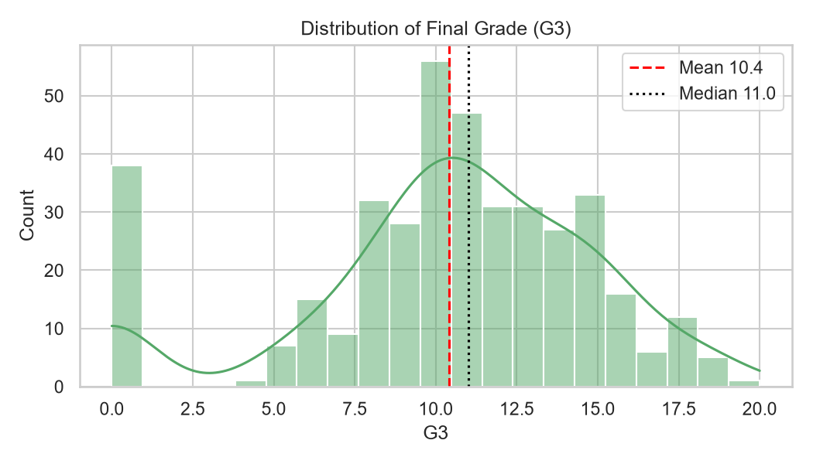
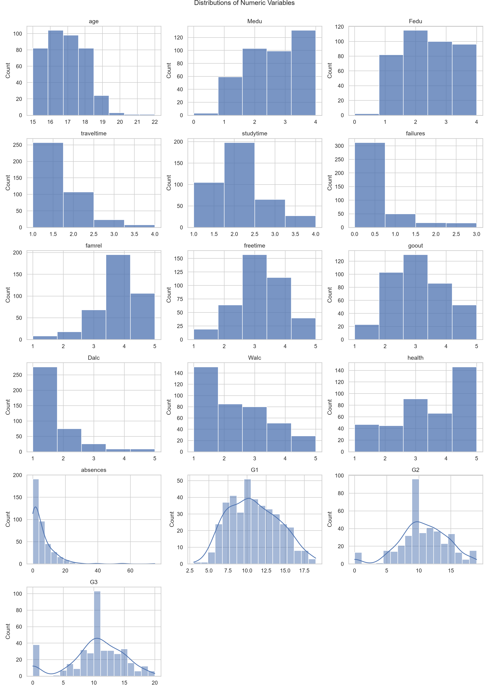
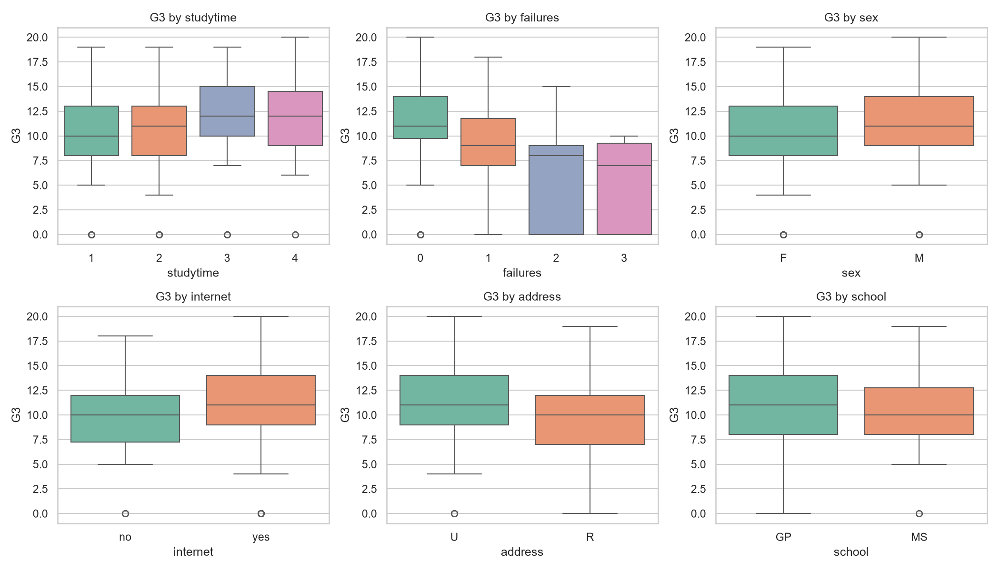
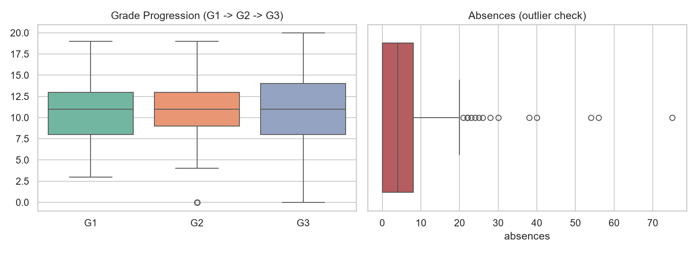
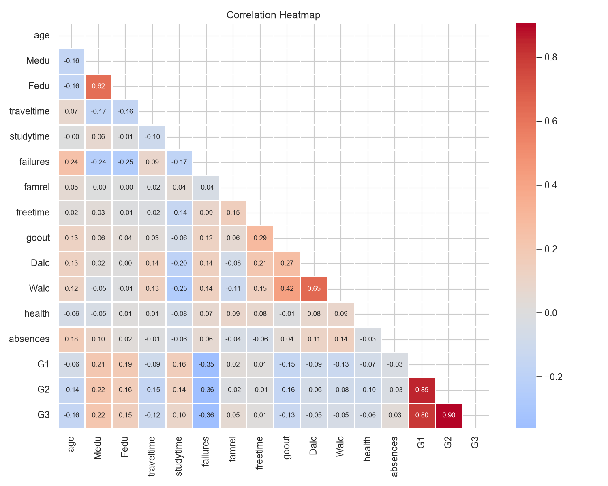

# Student Performance — Insights Report

## 1. Dataset Overview
- Raw data: **395 rows × 33 columns**; after cleaning: **395 rows**.
- Target variable: `G3` (final grade, 0–20 scale).

## 2. Data Quality & Cleaning
- Removed 0 duplicate rows.
- Flagged 0 implausible age values (outside 10-30) as missing.

## 3. Statistical Summary
- Mean final grade **10.42**, median **11.0**, std **4.58**, range 0–20.
- **67.1%** of students scored ≥ 10 (pass); **9.6%** scored 0 (possible drop-outs / non-attendance).
- Skewness of `G3`: -0.73 (left-skewed).

## 4. Key Findings
**Strongest correlations with final grade:**

- `G2`: r = +0.90 (positive)
- `G1`: r = +0.80 (positive)
- `failures`: r = -0.36 (negative)
- `Medu`: r = +0.22 (positive)
- `age`: r = -0.16 (negative)

- **Prior performance dominates.** G1 and G2 correlate 0.80 and 0.90 with final grade, so early-term grades are the best early-warning signal.
- **Past failures hurt.** Mean final grade by number of past failures: 0 → 11.25, 1 → 8.12, 2 → 6.24, 3 → 5.69.
- **Study time helps.** Mean final grade by study-time band (1=low … 4=high): 1 → 10.05, 2 → 10.17, 3 → 11.4, 4 → 11.26.
- **Absences:** students in the top quartile of absences average 10.48 vs 8.44 for the bottom quartile (r = +0.03).
- `sex`: F = 9.97, M = 10.91 (gap 0.94 points — small).
- `internet`: no = 9.41, yes = 10.62 (gap 1.21 points).
- `address`: R = 9.51, U = 10.67 (gap 1.16 points).
- `school`: GP = 10.49, MS = 9.85 (gap 0.64 points — small).
- **Grade trajectory:** average change from G1 to G3 is -0.49; 11.9% of students dropped by more than 2 points and 6.8% improved by more than 2 points.

## 5. Recommendations
1. **Early-warning system:** flag students with low G1/G2 or prior failures for tutoring before the final term.
2. **Attendance monitoring:** intervene when absences enter the top quartile.
3. **Study-skills support:** promote structured study time for students in the lowest study-time band.
4. **Investigate zero-grade records:** determine whether they are drop-outs, missing exams or data-entry errors.
5. **Equity checks:** review gaps by school, address and internet access for resource inequality.

## 6. Limitations
- Correlation is not causation; observational data cannot prove that study time *causes* higher grades.
- Median/mode imputation reduces variance; results may differ with multiple imputation.
- Findings from a single cohort may not generalise to other schools or years.